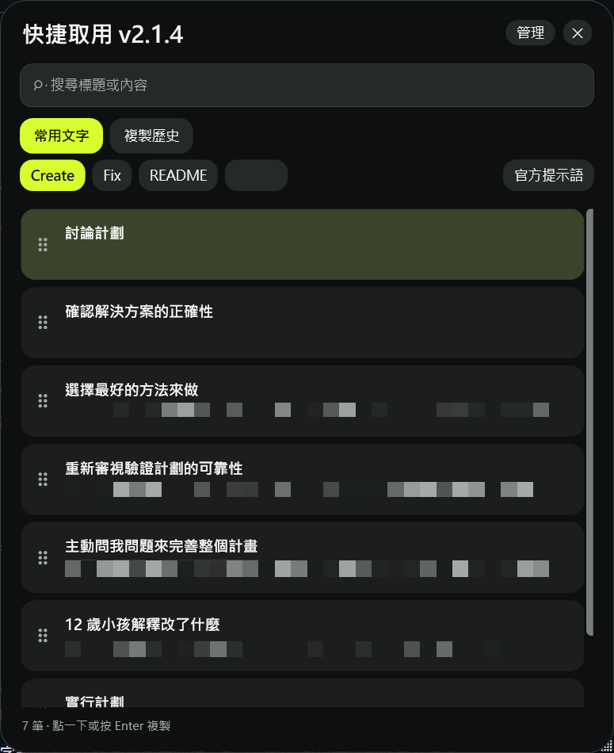

# 零零快捷剪貼板

把常用的回覆、範本或 AI 提示語存起來，需要時點一下就能複製，不用每次重新打字。

適用於 **Windows 64 位元電腦**，介面為繁體中文，不需要註冊帳號。

**[點這裡下載 v2.1.5](https://github.com/00vchannel/TseroShortClipBoard/releases/download/v2.1.5/ZeroZeroClipboard-win-x64-Portable.zip)**

## 第一次使用

1. 點上方下載連結。下載完成後，對下載的 ZIP 檔按滑鼠右鍵，選「全部解壓縮」。
2. 開啟解壓縮後的資料夾，雙擊「零零快捷剪貼板.exe」。請保留整個資料夾，不要只把這個檔案移走。
3. 第一次開啟時，點「開始使用」。文字列表是空白的，這是正常情況。

## 試著存一段文字

1. 點「＋ 新增文字」。
2. 在「標題」填入「常用回覆」，在下方大文字框填入「收到，我稍後回覆你。」。分類先保持「未分類」即可。
3. 點「儲存」。

現在到聊天視窗或記事本試試：

1. 按鍵盤右邊的 **Ctrl**，叫出文字面板。
2. 點剛剛的「常用回覆」，整段文字就會複製好，面板會自動收起。
3. 點一下想輸入文字的地方，再按 **Ctrl + V** 貼上。

文字變多時，可以在面板上方輸入關鍵字尋找。按 **Esc** 可以收起面板；點「管理」可以新增或修改文字。

## 直接使用內建的 AI 提示語

按右邊的 **Ctrl** 開啟面板，再點「官方提示語」，就能看到五筆現成內容，協助你與 AI 討論計劃、實行計劃或整理專案說明。

點想用的那一筆，再到 AI 聊天視窗按 **Ctrl + V** 貼上即可。這些是內建內容，可以複製，但不能修改。

## 常見問題

- **找不到剛剛複製的文字？** 在管理視窗左上方，把「常用文字」切換成「複製歷史」，可以找回最近 50 筆記錄。
- **字太小或想換顏色？** 點「設定與資料」→「設定」，可以放大文字或切換深色、淺色外觀，也能更改快捷鍵。
- **按右 Ctrl 沒反應？** 先確認程式已開啟，也可以在管理視窗點「快捷面板」。
- **關掉視窗後還在執行？** 這是為了讓快捷鍵繼續可用。要完全關閉，找到 Windows 右下角的程式小圖示（可能藏在「∧」裡），按右鍵選「結束」。
- **文字存在哪裡？** 存在這台電腦，不會自動同步到其他電腦。程式會自動備份；重要文字也可以從「設定與資料」→「手動備份」多存一份。
- **以後如何更新？** 有新版時，快捷面板會出現「更新並重啟」，點一下即可。

更多操作請看[完整使用說明](V2-使用說明.md)。
